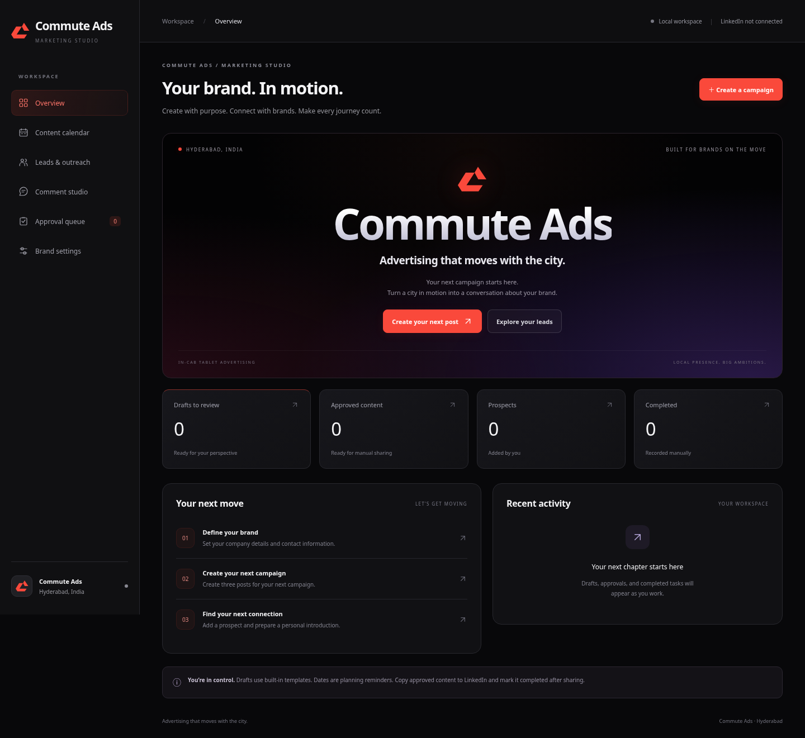

# Commute Ads — private marketing workspace

A dashboard for Commute Ads in Hyderabad, with English–Telugu post drafts, leads, comments, approvals, and private team accounts. Requires Node.js 22 or newer. Local Windows use needs no install step. Hosted PostgreSQL support installs its locked dependency with `npm ci`.



## Open on Windows without a command window

1. Download the repository using **Code → Download ZIP** and **Extract All**.
2. Open the extracted folder and double-click **OPEN-DASHBOARD.vbs**. Windows may display it as **OPEN-DASHBOARD**.
3. The app starts in the background and opens your browser. On first use, create your owner account; the launcher fills in the one-time setup code.
4. Use **Team & account** to change your password or add teammates.

Use **STOP-DASHBOARD.vbs** to stop the background server launched from this folder. Closing the browser does not stop the server. Only run one copy at a time. Windows Script Host must be available; the launcher has been reviewed but cannot be executed in this Linux development environment. If Windows does not run VBS files, **START-WINDOWS.bat** remains the diagnostic fallback. It shows startup errors. For manual first-time setup, read the local `.data/setup-code.txt` file and enter its code in the setup form. Do not share that code.

## Update an existing copy

This release changes the server as well as the dashboard. Stop the old app first. Download and extract the new ZIP, then copy **all of its files and folders** into your existing app folder, replacing old files. Keep your existing `.data` folder; it contains your saved work and is not included in the ZIP. Do not update only `public` for this release. Open **OPEN-DASHBOARD.vbs** and refresh with **Ctrl + F5**. Existing workspace records are retained; the first owner account now protects them.

## Free online team workspace — Render Free + Neon Free

[Create a free Neon database](https://console.neon.tech/) · [Deploy the free Render app](https://render.com/deploy?repo=https://github.com/chinturaju931-eng/test)

This configuration requests **Render Free**, creates **no Render database**, and requests **no paid disk**. Supply a PostgreSQL database from **Neon's Free plan**. No domain purchase is needed. Check that both accounts show Free; do not select paid upgrades. Provider free-plan availability and limits are controlled by those providers, not this app.

1. Sign in to Neon and create a project on its **Free plan**. Choose **Connect** and copy its PostgreSQL connection string. It contains a database password: keep it private and do not paste it in chat or commit it to GitHub. Pooled and direct Neon connection strings are supported, with certificate verification enabled.
2. Sign in to Render and use the deployment link above, or choose **New → Blueprint**, connect `chinturaju931-eng/test`, and choose branch `main`.
3. Confirm the service plan is **Free** and no disk or paid database is listed. When Render asks for **DATABASE_URL**, paste the Neon connection string into that secure environment setting. The Blueprint generates **SETUP_CODE** automatically.
4. Deploy. Render supplies an HTTPS address ending in `.onrender.com`; `RENDER_EXTERNAL_URL` configures the app's allowed origin automatically.
5. Privately copy **SETUP_CODE** from your Render service's **Environment** settings. Open the app's Render address, enter the code, and create the owner account. It cannot create another owner after setup is complete.
6. In **Team & account**, create accounts for your teammates. Share the Render address and their initial credentials privately. Ask each teammate to change their password after signing in. No account emails are sent automatically.

Free hosting can sleep when idle and take time to wake up. Free database/storage/usage quotas also apply. Login sessions expire on restarts, but accounts, leads, and drafts persist in PostgreSQL. This code has been tested with local PostgreSQL; no real Neon or Render account has been provisioned or validated from this workspace. Free services do not provide guaranteed uptime.

If you deployed an earlier **paid** Render service, changing this repository does not change or cancel its billing. Keep a backup of its `.data` directory and stop before changing plans. This release does not automatically move existing file data into PostgreSQL. Use a fresh free workspace, or arrange an explicit migration before removing the old service or disk.

Only the sign-in page and basic health status are public. Workspace APIs require a signed-in account. There is no public registration. All members can edit workspace content; only the owner can add/remove accounts. Removing access revokes the member's active sessions immediately. Sessions expire after 12 hours and after a server restart. Password changes revoke that user's other sessions.

The hosted workspace is shared by everyone using its Render address. Updates refresh every 20 seconds when you are not editing; Refresh also loads current changes. Saving against an older workspace version produces a conflict instead of silently replacing a teammate's work. Activity records show who made each content change.

Local copies and the hosted workspace are **separate data stores**. Existing local drafts are not automatically transferred to Render. For team work, use the Render address. The free online version stores data in PostgreSQL, so copying a local JSON file into Render's temporary filesystem will not import it. Database migration/import is a separate operation. Do not commit `.data` to GitHub. Use the one service configured by the Blueprint; do not scale local-file storage across instances.

The repository contains deployment configuration, not a live deployment. Render and Neon setup happens in your accounts; this repository does not create paid resources. No Render API credentials are stored in this project. Automatic deployment is disabled; deploy later changes deliberately from Render.

## Development and configuration

```sh
npm start
npm test
```

Default local address: loopback port 3000. `PORT`, `HOST`, and `DATA_DIR` override the defaults. Without `DATABASE_URL`, local data lives in `.data/workspace.json` and salted scrypt password hashes in `.data/accounts.json`. With `DATABASE_URL`, both are JSONB documents in the PostgreSQL `commuteads_documents` table; a revision check prevents concurrent overwrites. Accounts are refreshed across app instances before authorizing requests. These files are excluded from Git. For local use, back up the entire data directory. For PostgreSQL, back up the database. The in-app JSON export contains workspace records, not accounts. There is no email-based password recovery in this release.

Hosted mode uses `NODE_ENV=production`, `HOST=0.0.0.0`, `DATABASE_URL`, `REQUIRE_DATABASE=true`, an HTTPS `PUBLIC_URL` (or Render's `RENDER_EXTERNAL_URL`), and a random `SETUP_CODE` of at least 24 characters for first-time setup. With REQUIRE_DATABASE enabled, a missing database URL blocks startup rather than falling back to Render’s temporary filesystem. Invalid database connections block startup. Production also requires initial setup configuration. It uses Secure, HttpOnly, SameSite cookies, origin checks, and sign-in throttling. TLS is terminated by the hosting provider. Do not run hosted access in development mode. Setup codes, passwords, and account files must never be committed or shared in chat.

`npm test` exercises the marketing workflows, account privacy, owner permissions, revocation, persistence, concurrent updates, and production cookie/origin behavior. Optional browser smoke testing uses Python Playwright and Chromium: `python scripts/browser-smoke.py`. That script uses isolated temporary data and does not contact LinkedIn. The PostgreSQL test is skipped unless `COMMUTEADS_TEST_DATABASE_URL` points to a disposable test database; it creates and removes a unique schema. With that variable set, `npm test` also verifies persistence across fresh hosts, concurrent writes, and access revocation across instances. Windows launcher execution and actual Neon/Render provisioning require those platforms and are not validated by the Linux test suite.

## Marketing capabilities

- Three post drafts per campaign, with English and Telugu templates. Default planning cadence: one bilingual post every two days (campaign days 1, 3, 5).
- Prospects entered by your team, personalized message drafts, and opt-out suppression.
- Comment drafts using a source post and your own specific observation.
- Editing, review, approval, date planning, and manually recorded completion.
- Company details, activity history, and workspace export.

LinkedIn is not connected. Content uses templates rather than an LLM; topics stay as entered and are not automatically translated. Planned dates do not automatically publish. Posting, messages, and comments are shared manually. Marketing counters reflect workspace records, not LinkedIn engagement metrics.

Business defaults in `brand.js` include 10 tablets in Hyderabad (cab count unconfirmed), the Commute Ads page and website, connect@commuteads.com, and 6300081436. Pricing is discussed after connecting with a client. Target advertisers are brands across sectors with premium campaign budgets; this makes no claim about passengers' income.

Use the existing checkout in cloud tasks; do not create a worktree unless explicitly requested.
